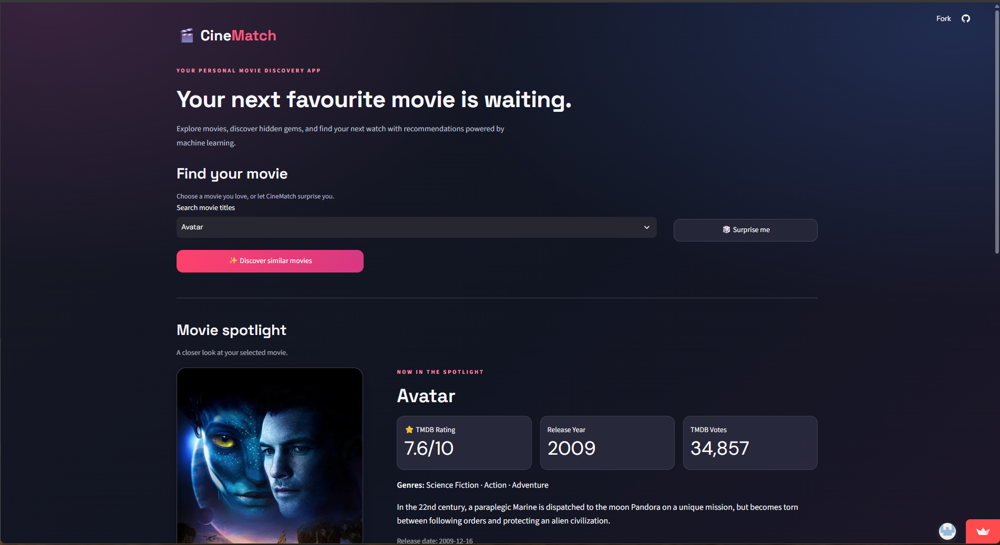
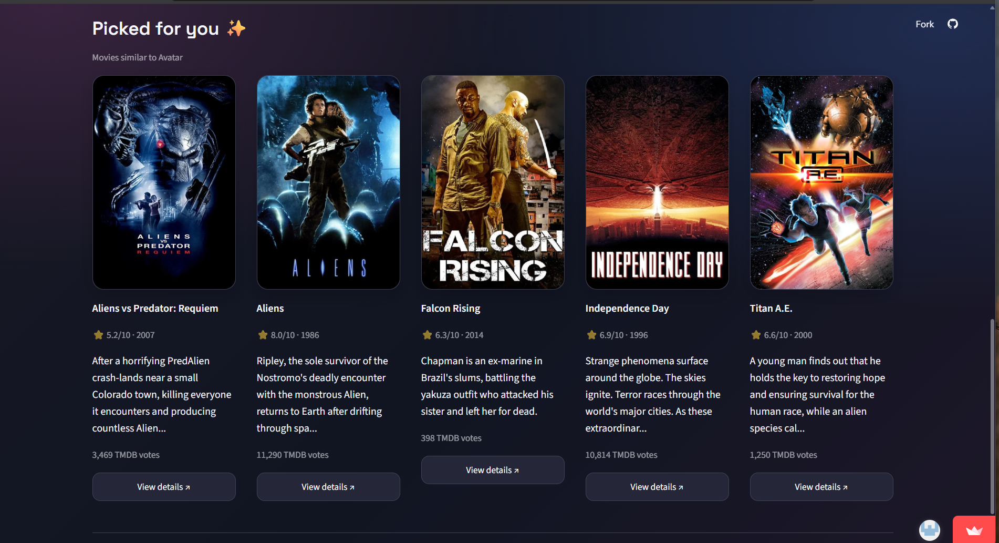
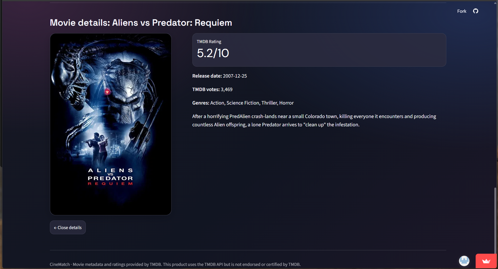

# CineMatch 🎬

A content-based movie recommendation app built with Python and
Streamlit. CineMatch uses text features and cosine similarity to
recommend movies, and the TMDB API to fetch available movie details and
posters.

## 🔗 Project Links

- **Live App:** [CineMatch](https://cinematch-movie-recommender-9p7nl5suemxhq8rocvlzym.streamlit.app/)
- - **GitHub Repository:** [CineMatch on GitHub](https://github.com/Prafful9999/cinematch-movie-recommender)
## 📸 Screenshots
### 🏠 Homepage


### 🎬 Recommendations


### 🎥 Movie Details


## 🛠️ Tech Stack

-   Python, Streamlit, Pandas
-   CountVectorizer and PorterStemmer
-   Cosine Similarity
-   TMDB API

## ⚙️ Run Locally

``` bash
git clone https://github.com/Prafful9999/cinematch-movie-recommender.git
cd cinematch-movie-recommender
pip install -r requirements.txt
streamlit run app.py
```

## 🔑 TMDB API Key

Configure `TMDB_API_KEY` in `.streamlit/secrets.toml` for local use or
in Streamlit Community Cloud **Settings → Secrets**. Never commit your
API key or `secrets.toml` to GitHub.
